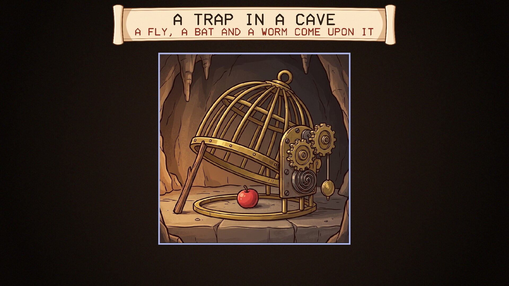
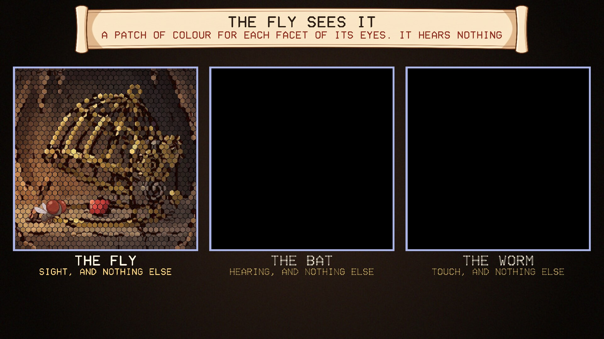
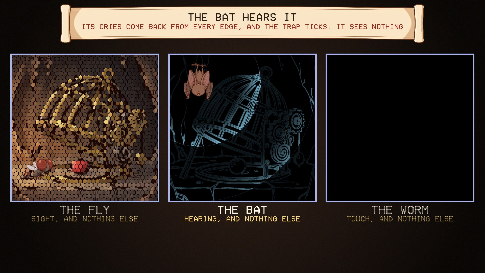
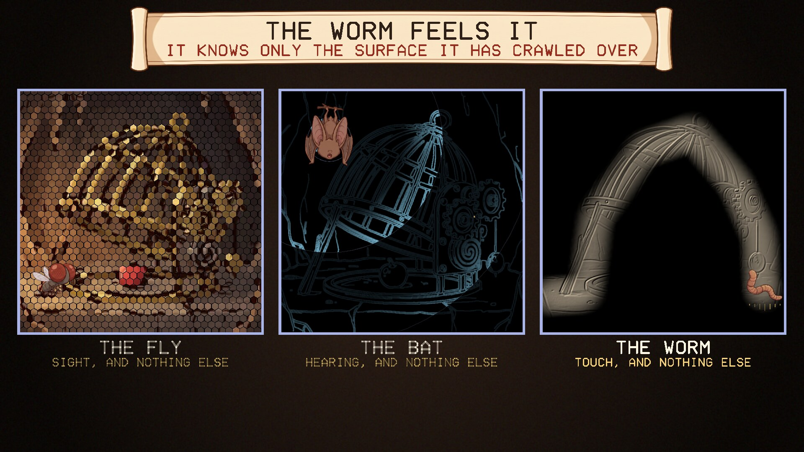

# Fly, Bat, Worm

A screensaver of the Fly, the Bat and the Worm, from Neal Stephenson's novel
*Anathem*. Runs on Linux, Windows and macOS. One of the
[Anathem screensavers](https://github.com/mottipython/anathem-screensavers).

## The idea

Three creatures come upon the same thing. The Fly has sight and nothing else; the
Bat has hearing and nothing else; the Worm has touch and nothing else. None of them
can tell the others what the thing is like, because what it is like for one means
nothing to the other two. But each can say where its parts are, and on that they
can agree. The argument drawn from it is that any mind which senses a world has to
build that world in space and time, so geometry is what all minds have in common.

## What the screensaver shows

One painting of a clockwork trap in a cave, about a minute and a half:

| | |
|---|---|
|  |  |
| The thing itself | The Fly: a patch of colour for each facet of its eyes |
|  |  |
| The Bat: its cries come back from every edge, and the trap ticks | The Worm: only the surface it has crawled over |

Then the three come together into the one picture again, with its shape drawn
over it in gold.

All three views are the same painting. The Bat's outlines and the Worm's relief are
worked out from it by `tools/make_sprites.py` (edge detection, and shading as if
lit from one side), so everything lines up with what the Fly sees.

### What is from the book and what is mine

From the book: the three creatures, one sense each, and the argument about what
they can and cannot share.

Mine: the trap being clockwork in a cave, which I remember but have not checked;
what each view looks like; and showing a bat's hearing as rings of sound, which is
a picture of echolocation and not something a bat sees.

## Install

Packages are on the [releases page](../../releases).

### Windows

Run `FlyBatWorm-Setup-1.0.0.exe`. It asks for administrator rights, because Windows
only lists screensavers that are in its own system folder. After that "Fly, Bat, Worm" is in Screen Saver Settings with the others, already selected. Uninstall from
Apps.

### macOS

There are two downloads on the releases page, for Apple Silicon and Intel, macOS 11
or later.

**The screen saver** is the file ending `-mac-screensaver.zip`. Unzip it and
double-click the `.saver` file; macOS offers to install it. Then choose it in System
Settings, Screen Saver (scroll to the end of the list, under Other).

**The app** is the file ending `-mac.zip`: the same thing as an ordinary program
that runs full screen until you press a key.

Neither is signed with an Apple developer certificate, so macOS will refuse them at
first. After the refusal, open System Settings, Privacy & Security, scroll down,
and click Open Anyway. If the screen saver still will not load, clear the
quarantine mark in Terminal:

    xattr -dr com.apple.quarantine ~/Library/"Screen Savers"

Both are built on a Mac build machine, where the screen saver is loaded and made to
draw as a test. They have not yet been tried by a person on a real Mac, and screen
savers on recent macOS are known to be temperamental; reports are welcome.

### Linux

**Fedora, Nobara** (built on Fedora 44):

    sudo dnf install ./fly-bat-worm-1.0.0-1.fc44.x86_64.rpm

**Debian, Ubuntu, Mint** (Ubuntu 24.04 / Debian 13 or later):

    sudo apt install ./fly-bat-worm_1.0.0_amd64.deb

From your next login it starts by itself after five minutes idle, and any key or
mouse movement ends it. To start the watcher without logging out, or to change the
delay:

    fly-bat-worm-screensaver enable 10    # after 10 minutes idle
    fly-bat-worm-screensaver disable
    fly-bat-worm-screensaver status
    fly-bat-worm-screensaver now          # run it right away

Wayland desktops have no screensaver service to plug into, so the package starts a
small idle watcher (`swayidle`) at login. It works on compositors that provide the
ext-idle-notify protocol: KDE Plasma, Sway, Hyprland, niri, COSMIC, labwc and
others. GNOME does not provide it, and on X11 you would add `fly-bat-worm` to
xscreensaver or your desktop's own idle settings. It does not lock the screen. If
one of the other *Anathem* screensavers
([Teglon](https://github.com/mottipython/teglon),
[the Lazy Peregrin](https://github.com/mottipython/lazy-peregrin),
[Cutting the Cake](https://github.com/mottipython/cutting-the-cake),
[the Clock of Saunt Edhar](https://github.com/mottipython/edhar-clock),
[the Weed War](https://github.com/mottipython/weed-war),
[the Daban Urnud](https://github.com/mottipython/daban-urnud),
[the Adrakhonic Theorem](https://github.com/mottipython/adrakhonic),
[the Analemma](https://github.com/mottipython/analemma),
[Bolt, Chord and Sphere](https://github.com/mottipython/bolt-chord-sphere),
[the Wick](https://github.com/mottipython/wick),
[A Fraa in Orbit](https://github.com/mottipython/fraa-in-orbit)) is already on screen it stays out of the way.

If [screensaver-service](https://github.com/mottipython/screensaver-service) is
installed, Fly, Bat, Worm appears in its list of screen savers, and that service starts
it in place of the watcher described above.

## Running it yourself

    fly-bat-worm              full screen on every display; any key or mouse movement quits
    fly-bat-worm --window     in a window; Esc or Q quits
    fly-bat-worm --speed 2    faster
    fly-bat-worm --snapshot out.bmp --time 60 --size 1920x1080

## Building

Needs a C compiler, make and SDL2 (2.0.18 or newer). Build from the top of the
source tree, because the pictures in `assets/art` are built into the program.

    make
    make check
    sudo make install

Packages are written to `dist/`. `tools/Containerfile` describes a container with
everything they need:

    podman build -t anathem-build -f tools/Containerfile tools
    podman run --rm --security-opt label=disable -v "$PWD":/src -w /src anathem-build make dist

## Credits and licence

MIT. *Anathem* and the Fly, the Bat and the Worm are Neal Stephenson's; this is an
unofficial fan project.

The painting of the trap and the three creatures were drawn with Google Gemini and
prepared by `tools/make_sprites.py`. Images are decoded with
[stb_image](https://github.com/nothings/stb) (public domain).
